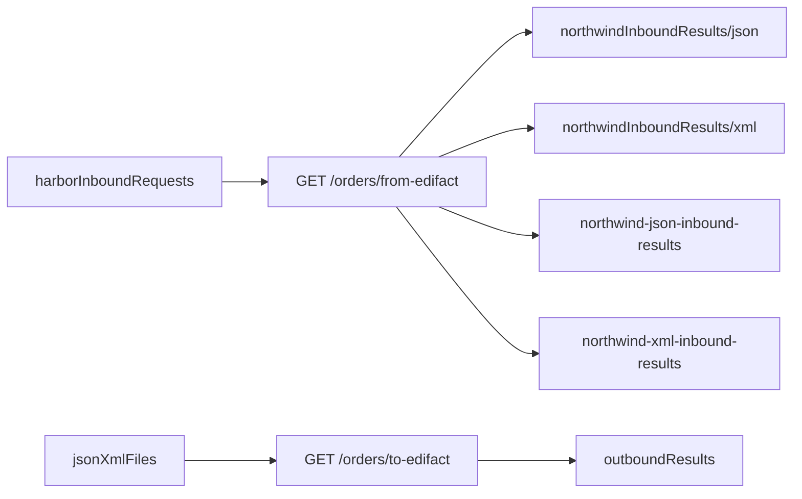

# EDIFACT Orders POC

Harbor sends EDIFACT ORDERS D96A. This Mule application reads those files from SFTP, maps them to a canonical purchase order, and publishes JSON and XML to Solace and SFTP. The reverse path reads a canonical JSON or XML file and writes an ORDERS message back to SFTP.

## Runtime

- Mule runtime `4.12.2`
- Java 17
- HTTP listener on `0.0.0.0:8081` (`http.host` and `http.port` in `src/main/resources/config.yaml`)

## Prerequisites

- Anypoint Studio with this project open
- Network access to the SFTP host configured by `sftp.host`, `sftp.port`, `sftp.username`, and `sftp.password`
- Network access to the Solace broker configured by `solace.host`, `solace.vpn`, `solace.username`, and `solace.password`

Credentials stay in `src/main/resources/config.yaml`. This document does not repeat them.

These SFTP folders must already exist:

- `harborInboundRequests`
- `jsonXmlFiles`
- `northwindInboundResults/json`
- `northwindInboundResults/xml`
- `outboundResults`

These Solace queues must already exist:

- `northwind-json-inbound-results`
- `northwind-xml-inbound-results`

## Flow



`GET /orders/from-edifact?file=` reads a D96A ORDERS file from `harborInboundRequests`, maps it with `src/main/resources/dw/purchase-order.dwl`, then writes JSON and XML and publishes both to Solace.

`GET /orders/to-edifact?file=` reads JSON or XML from `jsonXmlFiles`, builds EDIFACT with `src/main/resources/dw/orders-to-edifact.dwl`, and writes `outboundResults/<name>.edi`.

## Seed SFTP

Copy the packaged samples onto SFTP before calling the APIs. The Postman collection’s `GET /orders/upload-sample` request is not implemented, and its notes still mention older folder names (`edi/` and `inboundResults`). Use the folders below.

| Local file | SFTP folder |
| --- | --- |
| `src/main/resources/samples/orders-accepted.edi` | `harborInboundRequests` |
| `src/main/resources/samples/orders-rejected.edi` | `harborInboundRequests` |
| `src/main/resources/samples/canonical/orders-accepted.json` | `jsonXmlFiles` |
| `src/main/resources/samples/canonical/orders-rejected.json` | `jsonXmlFiles` |
| `src/main/resources/samples/canonical/orders-accepted.xml` | `jsonXmlFiles` |
| `src/main/resources/samples/canonical/orders-rejected.xml` | `jsonXmlFiles` |

## Run

Open the project in Anypoint Studio and run `edifact-orders-poc`. The listener is `http://localhost:8081`.

## End-to-end calls

Inbound, after the `.edi` files are in `harborInboundRequests`:

```text
GET http://localhost:8081/orders/from-edifact?file=orders-accepted.edi
GET http://localhost:8081/orders/from-edifact?file=orders-rejected.edi
```

Outbound, after the canonical files are in `jsonXmlFiles`. JSON and XML both work. The output name is the source name with `.edi`.

```text
GET http://localhost:8081/orders/to-edifact?file=orders-accepted.json
GET http://localhost:8081/orders/to-edifact?file=orders-accepted.xml
GET http://localhost:8081/orders/to-edifact?file=orders-rejected.json
GET http://localhost:8081/orders/to-edifact?file=orders-rejected.xml
```

## Expected outcomes

`orders-accepted` is purchase order `PO-1001`. Status is `ACCEPTED`, currency is `PHP`, order total is `25000`, and `reasons` is empty.

`orders-rejected` is purchase order `PO-1002`. Status is `REJECTED` with reasons `INVALID_QUANTITY` and `CREDIT_LIMIT_EXCEEDED`. Line 1 has quantity `0`. The order total is `200000`, which is above `rules.creditLimit` (`100000`).

Inbound results land in:

- `northwindInboundResults/json/<file-base-name>.json`
- `northwindInboundResults/xml/<file-base-name>.xml`
- Solace queue `northwind-json-inbound-results`
- Solace queue `northwind-xml-inbound-results`

Outbound results land in `outboundResults/<file-base-name>.edi`. The outbound flow does not re-run the accept or reject rules. It writes the EDIFACT message for the canonical file it was given. The HTTP response echoes `status` and `reasons` from that file.

## Validation rules

`purchase-order.dwl` accepts an order only when every check passes. Otherwise `status` is `REJECTED` and `reasons` lists the failures.

- Currency must be `rules.currency` (`PHP`). Otherwise `UNSUPPORTED_CURRENCY`.
- Every line quantity must be greater than `0`. Otherwise `INVALID_QUANTITY`.
- Every line unit price must be greater than `0`. Otherwise `INVALID_PRICE`.
- When both dates are present, the requested delivery date must not be before the order date. Otherwise `DELIVERY_BEFORE_ORDER`.
- Order total must not exceed `rules.creditLimit` (`100000`). Otherwise `CREDIT_LIMIT_EXCEEDED`.

## Errors

A missing `file` query parameter, a missing SFTP object, or a connector failure returns HTTP 500 and a JSON body:

```json
{ "message": "..." }
```
